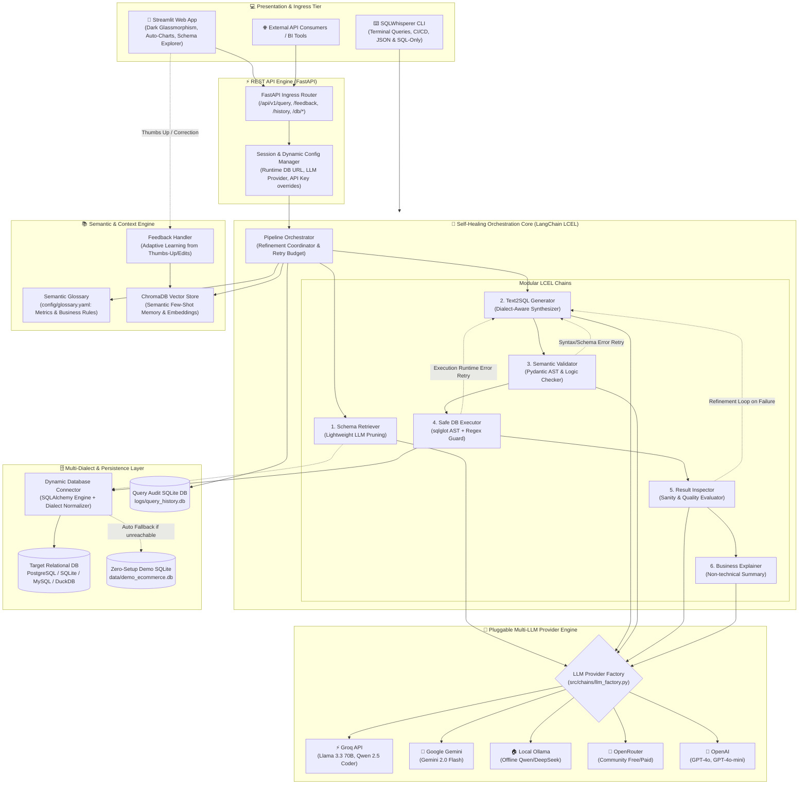
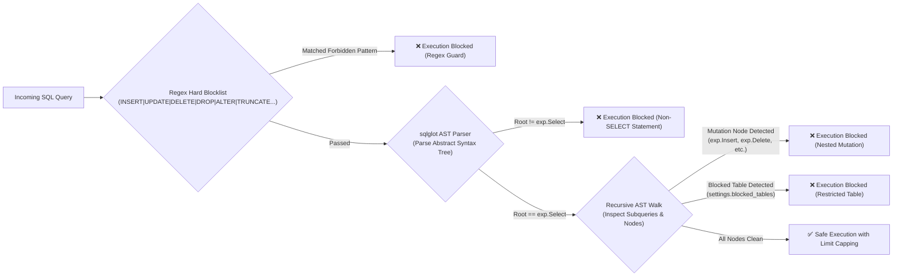
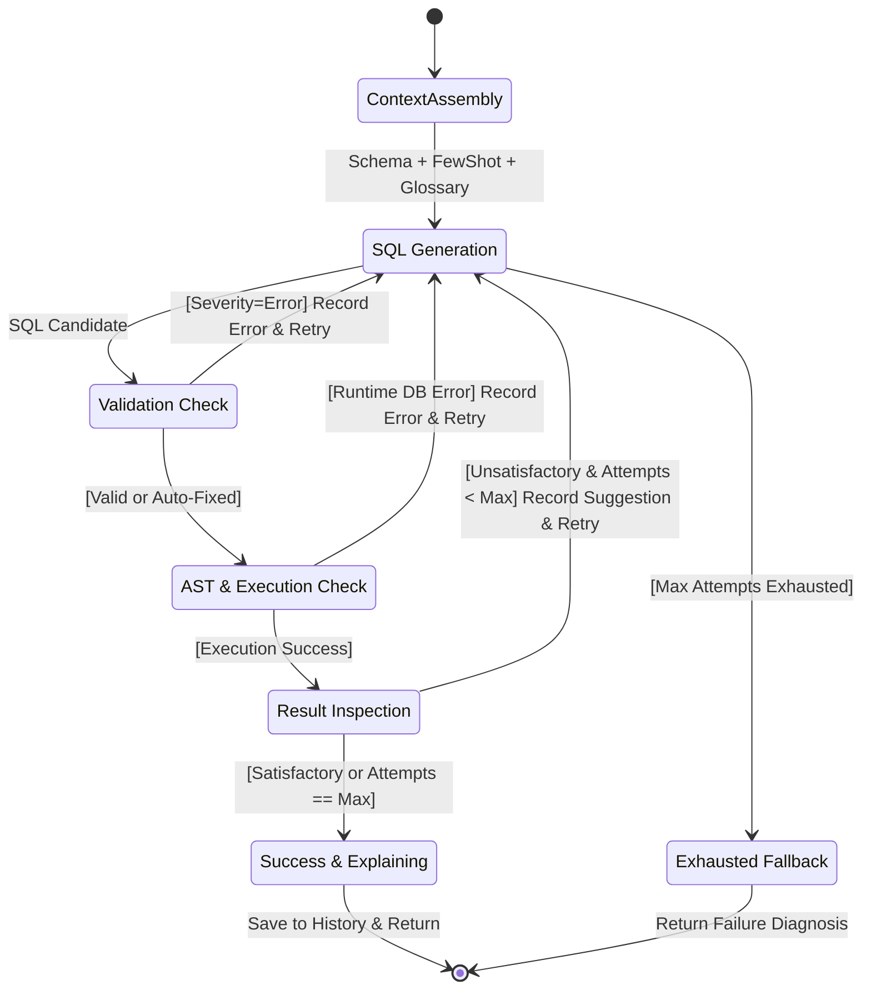
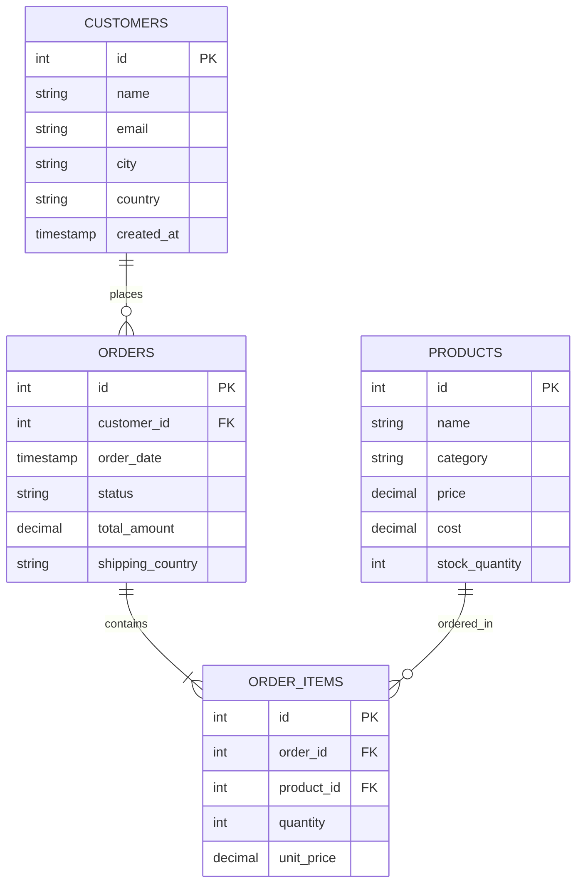
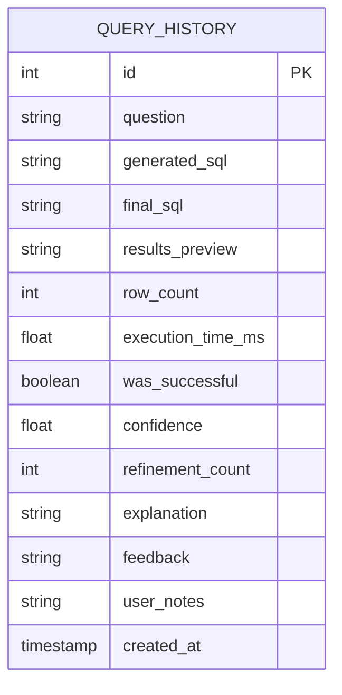
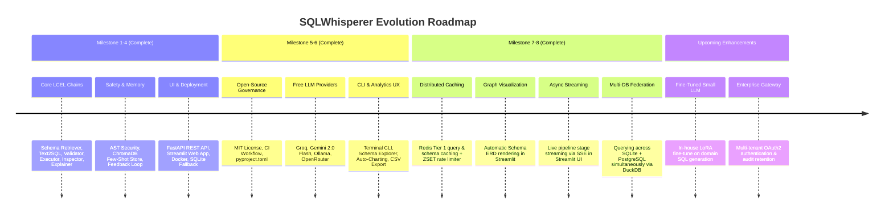

<div align="center">

# 🔮 SQLWhisperer — System Architecture & Technical Blueprint
**Production-Grade Natural Language to SQL Engine with Self-Healing, AST Guardrails, and Adaptive Learning**

[](#)
[](#)
[](#)
[](#)
[](#)

---

</div>

## 📑 Table of Contents
1. [Executive Architectural Vision](#1-executive-architectural-vision)
2. [High-Level System Topology](#2-high-level-system-topology)
3. [Deep-Dive Layer Architecture](#3-deep-dive-layer-architecture)
   - [3.1 Presentation & Interface Tier](#31-presentation--interface-tier)
   - [3.2 API & Ingress Service Tier](#32-api--ingress-service-tier)
   - [3.3 LangChain LCEL Self-Healing Orchestration Core](#33-langchain-lcel-self-healing-orchestration-core)
   - [3.4 Semantic Layer & Domain Glossary](#34-semantic-layer--domain-glossary)
   - [3.5 Deterministic AST & Safety Guardrails](#35-deterministic-ast--safety-guardrails)
   - [3.6 Adaptive Vector Memory & Feedback Loop](#36-adaptive-vector-memory--feedback-loop)
   - [3.7 Multi-Dialect Database & Persistence Tier](#37-multi-dialect-database--persistence-tier)
   - [3.8 Pluggable Multi-LLM Provider Engine](#38-pluggable-multi-llm-provider-engine)
4. [End-to-End Execution Flow & State Machine](#4-end-to-end-execution-flow--state-machine)
5. [Self-Healing Refinement Loop Deep Dive](#5-self-healing-refinement-loop-deep-dive)
6. [Security & Isolation Matrix](#6-security--isolation-matrix)
7. [Data Architecture & Schema Topology](#7-data-architecture--schema-topology)
8. [Physical Repository Structure & Component Map](#8-physical-repository-structure--component-map)
9. [Key Architectural Decisions (ADRs)](#9-key-architectural-decisions-adrs)
10. [Future Evolution Roadmap](#10-future-evolution-roadmap)

---

## 1. Executive Architectural Vision

**SQLWhisperer** is an enterprise-grade AI system that safely translates natural language business questions into highly optimized, deterministic SQL queries. Unlike naive text-to-SQL prototypes that suffer from schema hallucinations, silent logic flaws, and severe SQL injection vulnerabilities, SQLWhisperer applies an **agentic, multi-stage pipeline** with:

* **Strict Dual-Layer Safety**: AST parsing via `sqlglot` + regex pattern interception guarantees strictly read-only `SELECT` queries with recursive mutation prevention.
* **Autonomous Self-Healing**: Dynamic error feedback loops autonomously diagnose syntax issues, schema mismatches, and empty/suspicious data, executing up to 3 refinement iterations.
* **Continuous Reinforcement**: Thumbs-up feedback and expert corrections are embedded directly into ChromaDB vector memory, augmenting future queries with domain-specific few-shot context.
* **Zero-Friction Portability**: Zero-setup SQLite demo fallback with automatic synthetic data seeding alongside native enterprise PostgreSQL and custom connection strings.
* **Model Agnostic**: Hot-swappable AI backends across Groq (Llama 3.3 70B, Qwen 2.5 Coder), Google Gemini (Gemini 2.0 Flash), Ollama (local offline models), OpenRouter, and OpenAI.

---

## 2. High-Level System Topology



---

## 3. Deep-Dive Layer Architecture

### 3.1 Presentation & Interface Tier
* **Streamlit Web Application (`streamlit_app/app.py`)**:
  - **Aesthetic**: Premium dark glassmorphism theme (`#0d0b21` to `#1e1b4b`), custom CSS tokens, metric badges, and interactive feedback widgets.
  - **Interactive Database Management**: Instant switching between embedded demo SQLite, local SQLite upload via drag-and-drop, or custom PostgreSQL/MySQL connection strings.
  - **Live Schema Explorer**: Real-time schema viewer displaying column types, primary key flags, nullability, row counts, and live 3-row data samples.
  - **In-Browser Model & Key Switcher**: Ability to toggle between Groq, Gemini, Ollama, OpenRouter, and OpenAI with runtime key injection.
  - **Analytics & Auto-Charting**: Automatic detection of categorical + numeric columns producing instant Bar, Line, or Area charts with 1-click CSV download.
* **Terminal CLI (`src/cli/main.py`)**:
  - `sqlwhisperer query "<question>"`: Direct terminal queries with rich ANSI formatted tables.
  - `--sql-only`: Output strictly raw SQL (ideal for piping into `psql`, `sqlite3`, or Bash scripts).
  - `--explain`: Include executive natural language findings.
  - `--json`: Emit full structured JSON payload for CI/CD automation pipelines.
  - `sqlwhisperer health`: Check database connectivity and active LLM configuration.

---

### 3.2 API & Ingress Service Tier
Built with **FastAPI** (`src/api/app.py`, `src/api/routes.py`), providing an asynchronous, typed REST API adhering to OpenAPI specifications:

| Endpoint | Method | Input Schema | Response Schema | Purpose |
| :--- | :--- | :--- | :--- | :--- |
| `/api/v1/query` | `POST` | `QueryRequest` | `QueryResponse` | Runs natural language to SQL through the self-healing pipeline |
| `/api/v1/feedback` | `POST` | `FeedbackRequest` | `FeedbackResponse` | Submits thumbs up/down and user-corrected SQL to memory |
| `/api/v1/history` | `GET` | `limit: int = 20` | `list[HistoryItem]` | Retrieves chronological audit trail of executed queries |
| `/api/v1/health` | `GET` | None | `HealthResponse` | Liveness and readiness probe with dialect diagnostics |
| `/api/v1/db/test` | `POST` | `DatabaseConnectRequest` | `DatabaseTestResponse` | Validates target database URL and returns discovered tables |
| `/api/v1/db/schema`| `GET` | `database_url: str?` | `list[TableSchemaInfo]` | Full DDL reflection, column metadata, and sample rows |
| `/api/v1/db/upload`| `POST` | `UploadFile (.db)` | `dict` | Accepts SQLite database uploads and stores in `data/user_uploads/` |

---

### 3.3 LangChain LCEL Self-Healing Orchestration Core
Built as a composable LangChain Expression Language (LCEL) graph coordinated in `src/chains/pipeline.py`:

```
┌─────────────────────────────────────────────────────────────────────────────┐
│                           ORCHESTRATION PIPELINE                            │
│                                                                             │
│  User Input: "Show top 5 customers by spend in 2026"                        │
│       │                                                                     │
│       ▼                                                                     │
│  [1. Schema Retriever]  ──► Discovers 'customers', 'orders', 'order_items'  │
│       │                                                                     │
│       ├───────────────────► [Semantic Glossary] (injects revenue & AOV rules)│
│       │                                                                     │
│       ├───────────────────► [ChromaDB Store] (injects 3 similar examples)   │
│       ▼                                                                     │
│  [2. Text2SQL Chain]    ──► Synthesizes dialect-specific SELECT query       │
│       │                                                                     │
│       ▼                                                                     │
│  [3. Validation Chain]  ──► AST & logic analysis (Auto-fixes minor issues)  │
│       │                                                                     │
│       ▼                                                                     │
│  [4. Execution Chain]   ──► sqlglot AST verification + Safe DB execution    │
│       │                                                                     │
│       ▼                                                                     │
│  [5. Inspector Chain]   ──► AI data quality audit (Checks row count/sanity) │
│       │                                                                     │
│       ▼                                                                     │
│  [6. Explainer Chain]   ──► Plain-English business summary & caveats        │
│       │                                                                     │
│       ▼                                                                     │
│  [7. History Store]     ──► Audited to SQLite query history database        │
└─────────────────────────────────────────────────────────────────────────────┘
```

#### Detailed Sub-Chain Matrix:
1. **Schema Retriever (`src/chains/schema_retriever.py`)**:
   - Two-stage retrieval: First runs a low-latency LLM call with list of table names to select only relevant tables.
   - Then runs SQLAlchemy metadata inspection to extract columns, types, primary keys, foreign keys, and 3 sample rows for selected tables.
   - **Benefit**: Drastically reduces prompt token consumption and eliminates confusion caused by irrelevant tables.
2. **Text2SQL Synthesizer (`src/chains/text2sql.py`)**:
   - Injects normalized dialect rules (`SQLite`, `PostgreSQL`, `MySQL`), target DDL schema, retrieved few-shot examples, semantic business formulas, and past failed attempts (if in a retry loop).
   - Enforces strict constraints: no markdown formatting, explicit column selection (bans `SELECT *`), mandatory aliases, explicit NULL handling.
3. **Validator Chain (`src/chains/validator.py`)**:
   - Structured Pydantic validation (`ValidationResult`) evaluating syntax errors, table/column hallucination, join cartesian products, and aggregate `GROUP BY` compliance.
   - Contains an **Auto-Fixer**: Returns `fixed_sql` when a trivial syntax or dialect glitch is identified, bypassing an expensive full re-generation cycle.
4. **Executor Chain (`src/chains/executor.py`)**:
   - Hardened database runner applying AST security analysis, table restriction check, regex blocklists, and row capping (`MAX_RESULT_ROWS = 100`).
   - Measures exact execution time in milliseconds and formats preview data.
5. **Result Inspector (`src/chains/inspector.py`)**:
   - Structured Pydantic inspection (`InspectionResult`).
   - Checks row-count sanity, column relevance against user intent, unexpected empty result sets, and negative/out-of-range values.
   - Emits confidence score (0.0 to 1.0) and specific suggestions if unsatisfactory.
6. **Business Explainer (`src/chains/explainer.py`)**:
   - Translates raw tabular results into concise, non-technical executive findings, performance commentary, and data boundary caveats.

---

### 3.4 Semantic Layer & Domain Glossary
Configured in `config/glossary.yaml` and resolved via `src/semantic/glossary.py`:
* **Metric Standardization**: Bridges company business jargon to precise SQL rules:
  - `"revenue"` $\rightarrow$ `SUM(orders.total_amount) WHERE orders.status != 'cancelled'`
  - `"active_customer"` $\rightarrow$ `orders with status IN ('confirmed', 'shipped', 'delivered') within last 90 days`
  - `"net_profit"` $\rightarrow$ `SUM((order_items.unit_price - products.cost) * order_items.quantity)`
  - `"aov"` $\rightarrow$ `AVG(orders.total_amount) excluding cancelled orders`
* **Synonym Expansion**: Automatically resolves domain synonyms:
  - `buyers`, `clients`, `users` $\rightarrow$ `customers`
  - `items`, `merchandise`, `skus` $\rightarrow$ `products`
  - `sales`, `purchases`, `transactions` $\rightarrow$ `orders`
* **Global Domain Rules**: Enforces strict business filters (e.g. automatically excluding cancelled orders unless explicitly requested).

---

### 3.5 Deterministic AST & Safety Guardrails
Security in SQLWhisperer operates on a **zero-trust, defense-in-depth** model:



1. **AST Root Verification (`sqlglot.parse`)**: Ensures every statement parsed is an instance of `exp.Select`. Multi-statement SQL injections (`SELECT 1; DROP TABLE customers;`) are rejected.
2. **Recursive Node Walking**: Scans internal abstract syntax tree nodes for subquery mutations (`SELECT * FROM (DELETE FROM ...)`) or unauthorized DDL operations.
3. **Restricted Table Enforcement**: Disallows querying sensitive internal schemas or administrative tables specified in `settings.blocked_tables`.
4. **Regex Defense-in-Depth**: Secondary fallback regex interceptor active regardless of whether `sqlglot` is installed.
5. **Bounded Execution**: Strict query timeout (`QUERY_TIMEOUT_SECONDS = 15`) and row-count capping (`MAX_RESULT_ROWS = 100`).

---

### 3.6 Adaptive Vector Memory & Feedback Loop
Implemented in `src/memory/few_shot_store.py` and `src/memory/feedback.py`:
* **ChromaDB Storage**: Persists successful `(Question, SQL, Explanation)` triplets with vector embeddings (`text-embedding-3-small` or local fallbacks).
* **Feedback-Driven Learning**:
  - When a user clicks **👍 Thumbs Up** in the Streamlit UI or calls `/api/v1/feedback`, the query is dynamically indexed in ChromaDB.
  - If a user provides **Corrected SQL**, the refined query is verified, saved to history, and embedded with high priority.
* **Contextual Few-Shot Retrieval**: On every incoming question, the top $k=3$ semantically similar verified queries are retrieved and injected into the Text2SQL prompt context.

---

### 3.7 Multi-Dialect Database & Persistence Tier
Implemented in `src/db/connector.py`, `src/db/history.py`, and `src/db/models.py`:
* **Dynamic Dialect Normalization**: Detects and adapts SQL formatting specifically for:
  - `PostgreSQL` (`DATE_TRUNC`, `::DATE`, `ILIKE`, `RETURNING`)
  - `SQLite` (`strftime`, `DATE('now', '-30 days')`, `LIKE`)
  - `MySQL` (`DATE_SUB`, `NOW()`, `LIMIT`)
  - `DuckDB` / `Snowflake` / `Oracle`
* **Zero-Setup Auto-Seeding SQLite Fallback**:
  - If `DATABASE_URL` is unreachable or PostgreSQL is not running, the connector automatically initializes `data/demo_ecommerce.db`.
  - Auto-populates 500 customers, 100 products, 2,000 orders, and realistic order item distributions.
* **Query History Audit Store (`logs/query_history.db`)**:
  - Persistent SQLite database recording every run: `id`, `question`, `generated_sql`, `final_sql`, `row_count`, `execution_time_ms`, `confidence`, `refinement_count`, `was_successful`, `feedback`, and `created_at`.

---

### 3.8 Pluggable Multi-LLM Provider Engine
Centralized in `src/chains/llm_factory.py`, decoupling business logic from any single AI vendor:

```
                          ┌───────────────────────────┐
                          │   get_chat_llm(temp)      │
                          └─────────────┬─────────────┘
                                        │
           ┌────────────────┬───────────┼───────────┬────────────────┐
           ▼                ▼           ▼           ▼                ▼
     ┌───────────┐    ┌───────────┐┌───────────┐┌───────────┐    ┌───────────┐
     │   Groq    │    │  Gemini   ││  Ollama   ││OpenRouter │    │  OpenAI   │
     │ Llama 3.3 │    │2.0 Flash  ││Qwen 2.5 C.││Free Models│    │  GPT-4o   │
     │ 100% Free │    │ 100% Free ││100% Local ││Community  │    │  Flagship │
     └───────────┘    └───────────┘└───────────┘└───────────┘    └───────────┘
```

* **Zero-Cost Deployment**: Built-in support for **Groq** (ultra-fast inference with Llama 3.3 70B & Qwen 2.5 Coder) and **Google Gemini 2.0 Flash** allows the system to run completely free of charge.
* **Complete Privacy / Air-Gapped**: Supports local offline execution through **Ollama** (`http://localhost:11434/v1`).
* **Runtime Dynamic Switching**: Users can select provider, model, and inject session API keys on the fly from the Streamlit UI without restarting any servers.

---

## 4. End-to-End Execution Flow & State Machine

```mermaid
sequenceDiagram
    autonumber
    actor User as User / Client
    participant UI as Streamlit / CLI
    participant API as FastAPI Ingress
    participant Orch as Pipeline Orchestrator
    participant Retriever as Schema & FewShot Retriever
    participant Text2SQL as Text2SQL Chain
    participant Validator as Validator Chain
    participant Exec as Safe Executor (sqlglot)
    participant DB as Target Database
    participant Inspector as Result Inspector
    participant Explainer as Explainer Chain
    participant Audit as SQLite Audit DB

    User->>UI: Submits Natural Language Query
    UI->>API: POST /api/v1/query { question, overrides }
    API->>Orch: invoke({ question })
    
    %% Context Retrieval
    activate Orch
    Orch->>Retriever: Retrieve Schema, Glossary & Few-Shots
    Retriever-->>Orch: Schema DDL + Business Rules + Examples
    
    %% Refinement Loop
    loop Refinement Attempt (1..3)
        Orch->>Text2SQL: Synthesize SQL (Question + Context + Error History)
        Text2SQL-->>Orch: Generated SQL
        
        Orch->>Validator: Validate SQL syntax, schema, logic
        alt Validator detects error (auto-fixable)
            Validator-->>Orch: Validated with fixed_sql
        else Validator detects fatal error
            Validator-->>Orch: Invalid (syntax/hallucination)
            Note over Orch: Append error to history; retry loop
        end

        Orch->>Exec: Execute SQL with AST Guardrails
        alt AST or Execution Error
            Exec-->>Orch: Execution Error (e.g. column not found)
            Note over Orch: Append execution error; retry loop
        else Execution Success
            Exec->>DB: Run SELECT query with row limits
            DB-->>Exec: Raw Rows & Column Metadata
            Exec-->>Orch: Rows, Row Count, Execution Time
            
            Orch->>Inspector: Inspect result sanity & completeness
            alt Results Suspicious / Empty & Retries Remaining
                Inspector-->>Orch: Unsatisfactory + Improvement Suggestion
                Note over Orch: Append suggestion to history; retry loop
            else Results Satisfactory or Retries Exhausted
                Inspector-->>Orch: Satisfactory (Confidence Score)
            end
        end
    end

    %% Explanation & Completion
    Orch->>Explainer: Generate Plain-English Business Insights
    Explainer-->>Orch: Business Summary & Caveats
    
    Orch->>Audit: Save Query Run (Latency, SQL, Confidence, Status)
    Audit-->>Orch: query_id
    
    Orch-->>API: QueryResponse Payload
    deactivate Orch
    API-->>UI: Render Data Table, Charts, Explanation, Thumbs Feedback
    UI-->>User: Visualized Query Results
```

---

## 5. Self-Healing Refinement Loop Deep Dive

The core innovation of SQLWhisperer is the **iterative feedback refinement loop** (`max_refinement_retries = 3`):



When an attempt fails at any stage (validation, database execution, or sanity inspection):
1. The exact query and the specific failure reason are appended to the `error_history` buffer.
2. On subsequent iterations, an explicit diagnostic section is appended to the prompt:
   ```text
   PREVIOUS ATTEMPTS THAT FAILED:
   - SQL: SELECT customer_name, SUM(total) FROM orders GROUP BY customer_id;
     Error: Execution: column "orders.customer_name" does not exist in schema.
   
   Do NOT repeat these mistakes. Try a different approach.
   ```
3. The LLM reflects on the failure, avoiding identical paths and producing corrected SQL.

---

## 6. Security & Isolation Matrix

| Threat Vector | Mitigation Strategy in SQLWhisperer | Enforcement Layer |
| :--- | :--- | :--- |
| **SQL Injection (Multi-Statement)** | AST parsing rejects any input where statements are chained or root is not `exp.Select` | `src/chains/executor.py` (`sqlglot`) |
| **Data Mutation (`DELETE`/`UPDATE`/`DROP`)** | AST tree-walking inspects all sub-nodes; regex hard blocklist rejects mutation verbs | Dual layer (`sqlglot` + Regex pattern) |
| **Sensitive Table Exposure** | `settings.blocked_tables` enforces exclusion via AST table token inspection | AST node inspection & Regex fallback |
| **Denial of Service (Runaway Queries)** | Configurable `QUERY_TIMEOUT_SECONDS` (15s default) terminates long executions | SQLAlchemy engine connection args |
| **Memory Exhaustion (OOM)** | Strict `MAX_RESULT_ROWS` (100 default) limits row fetch and payload serialization | Execution chain slicing |
| **Credential Security** | Sensitive keys configured via `.env` or session memory, never logged to stdout | `src/config/settings.py` (Pydantic) |
| **Container Privilege Escalation** | Multi-stage Docker containers running under unprivileged non-root users (`appuser`) | `Dockerfile.api`, `Dockerfile.streamlit` |

---

## 7. Data Architecture & Schema Topology

### 7.1 E-Commerce Target Schema (`scripts/init_db.sql` & `scripts/seed_sqlite.py`)


### 7.2 Query Audit & History Schema (`src/db/models.py`)


---

## 8. Physical Repository Structure & Component Map

```
Sql_bot/
├── .github/                      # CI/CD Workflows & GitHub Community Templates
│   ├── ISSUE_TEMPLATE/           # Bug report & feature request templates
│   └── workflows/ci.yml          # GitHub Actions multi-python test & lint matrix
├── config/                       # Business & Domain Configuration
│   └── glossary.yaml             # Semantic metrics, business rules, and synonyms
├── data/                         # Database Storage & Uploads
│   ├── demo_ecommerce.db         # Auto-generated zero-setup SQLite demo DB
│   └── user_uploads/             # User-uploaded SQLite databases
├── logs/                         # Application Logs & Query Audit DB
│   └── query_history.db          # SQLite persistent audit ledger
├── scripts/                      # Database Initialization & Tooling
│   ├── init_db.sql               # PostgreSQL demo database DDL
│   ├── project_tracker.py        # Automated dev ledger & health tracker
│   ├── seed_db.py                # PostgreSQL synthetic data generator (2,000 rows)
│   ├── seed_few_shots.py         # Curated few-shot seeding into ChromaDB
│   └── seed_sqlite.py            # SQLite demo seeding engine
├── src/                          # Application Core Source Code
│   ├── api/                      # REST API Layer (FastAPI)
│   │   ├── app.py                # FastAPI app initialization, CORS, middleware
│   │   └── routes.py             # Route handlers (/query, /feedback, /db/*)
│   ├── chains/                   # LangChain LCEL Pipelines & Self-Healing
│   │   ├── executor.py           # Safe DB executor with sqlglot AST parsing
│   │   ├── explainer.py          # Business summary generator
│   │   ├── inspector.py          # Result sanity & data quality auditor
│   │   ├── llm_factory.py        # Multi-provider LLM factory (Groq, Gemini, Ollama...)
│   │   ├── pipeline.py           # Self-healing refinement orchestrator
│   │   ├── schema_retriever.py   # Two-stage LLM table pruning & DDL reflection
│   │   ├── text2sql.py           # Dialect-aware SQL synthesizer
│   │   └── validator.py          # Structured SQL syntax & schema validator
│   ├── cli/                      # Command-Line Interface
│   │   └── main.py               # sqlwhisperer CLI tool (query, health)
│   ├── config/                   # Configuration Management
│   │   └── settings.py           # Pydantic BaseSettings environment loader
│   ├── db/                       # Database Abstraction & Persistence
│   │   ├── connector.py          # Multi-dialect engine & auto SQLite fallback
│   │   ├── history.py            # Audit repository query history manager
│   │   └── models.py             # SQLAlchemy ORM models for query history
│   ├── memory/                   # Adaptive Memory & Feedback Learning
│   │   ├── feedback.py           # User thumbs up/down feedback handler
│   │   └── few_shot_store.py     # ChromaDB vector store for semantic retrieval
│   ├── schemas/                  # Pydantic v2 Request & Response Contracts
│   │   ├── request.py            # QueryRequest, FeedbackRequest, DatabaseConnectRequest
│   │   └── response.py           # QueryResponse, HistoryItem, TableSchemaInfo
│   └── semantic/                 # Semantic Business Intelligence Layer
│       └── glossary.py           # Dynamic business term and synonym matcher
├── streamlit_app/                # Web Presentation Layer
│   └── app.py                    # Streamlit interactive UI with auto-charting
├── tests/                        # Automated Test Suite
│   ├── test_chains/              # Unit tests for executor, validator, pipeline
│   └── test_semantic.py          # Unit tests for semantic glossary matcher
├── .env.example                  # Environment configuration template
├── docker-compose.yml            # Multi-service container orchestration
├── Dockerfile.api                # FastAPI container specification
├── Dockerfile.streamlit          # Streamlit UI container specification
├── pyproject.toml                # PEP 621 packaging & tool configs (Ruff, Pytest)
├── run.bat / stop.bat            # Windows 1-click execution scripts
└── README.md                     # Project overview & quickstart guide
```

---

## 9. Key Architectural Decisions (ADRs)

### ADR-001: LangChain LCEL over Monolithic Agent Frameworks
* **Context**: Agent frameworks like CrewAI or AutoGen can be non-deterministic, slow, and prone to runaway reasoning loops.
* **Decision**: Adopt **LangChain Expression Language (LCEL)** to construct explicit, deterministic runnables chained into a structured refinement loop.
* **Outcome**: Full observability, sub-second chain transitions, typed input/output validation, and reproducible behavior.

### ADR-002: Dual-Layer AST Guardrails with `sqlglot`
* **Context**: Regular expressions can be bypassed by comments (`--`, `/* */`), sub-select mutations, or obscure dialect syntaxes.
* **Decision**: Enforce programmatic Abstract Syntax Tree (AST) validation using `sqlglot`. Ensure the statement root is `exp.Select` and recursively inspect all AST nodes for forbidden mutations.
* **Outcome**: Complete protection against destructive SQL operations, even in complex nested subqueries.

### ADR-003: Two-Stage Schema Retrieval
* **Context**: Feeding an entire enterprise database schema (50+ tables) into the Text2SQL prompt exhausts context tokens, increases latency, and causes hallucinated JOINs.
* **Decision**: Execute a lightweight LLM table selector that identifies the exact 2–4 relevant tables, then fetch full DDL and sample rows for only those tables.
* **Outcome**: 70%+ reduction in prompt tokens and higher SQL generation accuracy.

### ADR-004: In-Memory / Local Zero-Setup SQLite Fallback
* **Context**: Requiring users to configure and run PostgreSQL locally creates immense onboarding friction.
* **Decision**: Embed an automatic fallback in `src/db/connector.py`. If PostgreSQL is not reachable, transparently generate and seed an SQLite database (`demo_ecommerce.db`).
* **Outcome**: Zero-setup developer experience: the system works out-of-the-box in under 60 seconds.

### ADR-005: 100% Free AI Backends (Groq & Gemini)
* **Context**: Relying exclusively on paid OpenAI API keys limits community adoption and user experimentation.
* **Decision**: Implement an LLM factory supporting **Groq** (free Llama 3.3 70B & Qwen 2.5 Coder) and **Google Gemini** free tier alongside offline **Ollama**.
* **Outcome**: Any developer can run the entire platform at zero dollar cost.

---

## 10. Future Evolution Roadmap



---

<div align="center">
  <sub>SQLWhisperer Architecture Blueprint • Maintained by the Core Engineering Team</sub>
</div>
