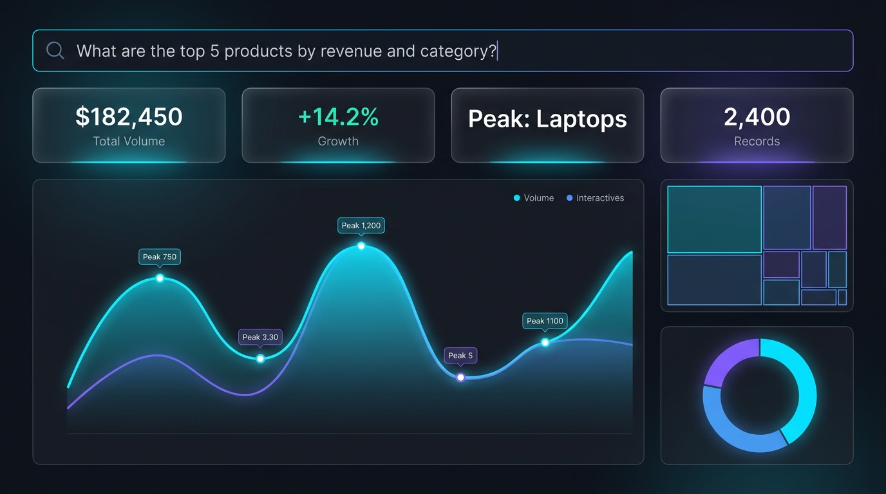
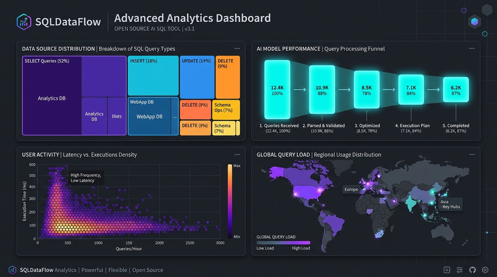
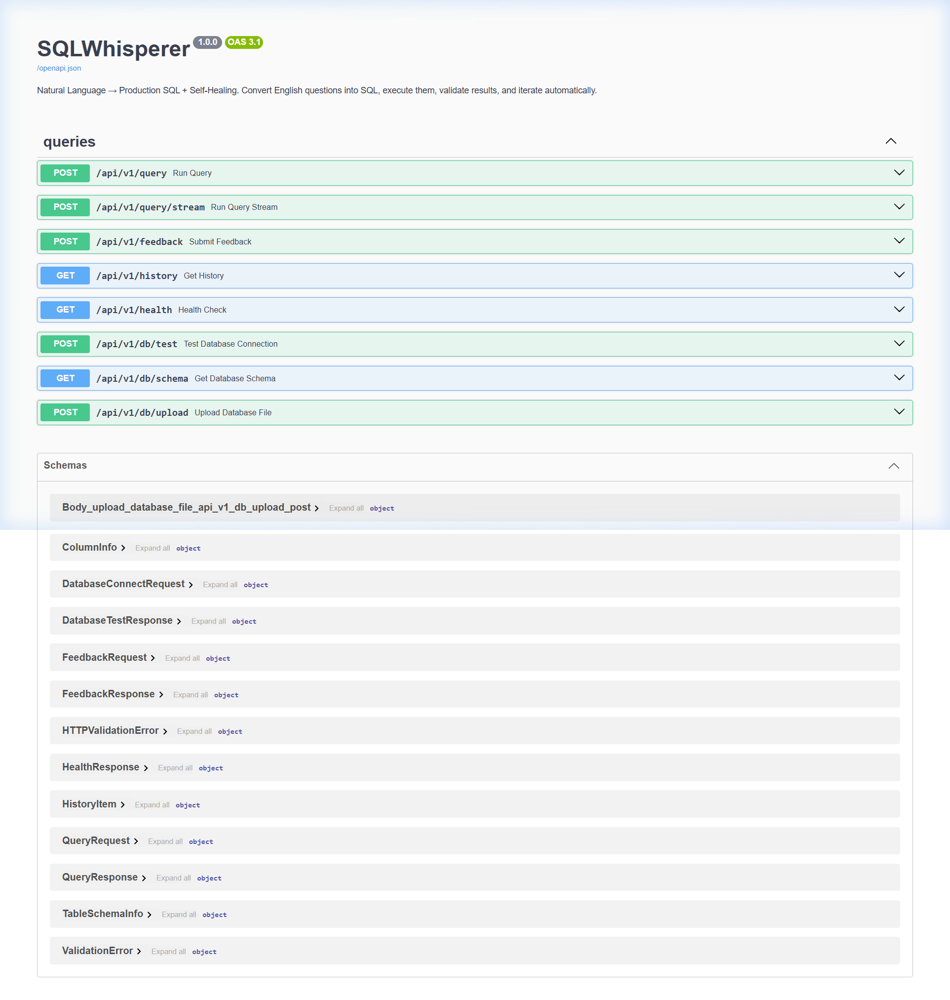
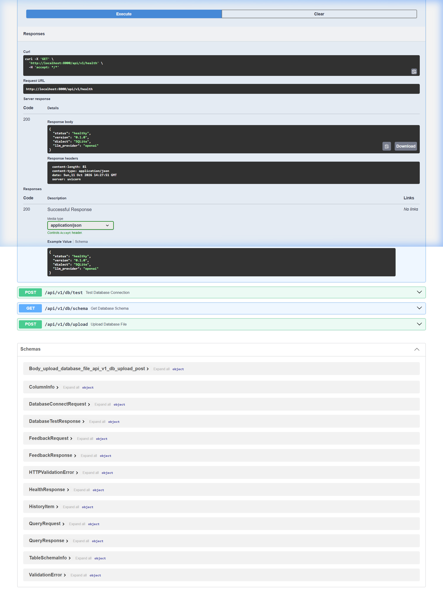

<div align="center">

# 🔮 SQLWhisperer

### Autonomous Natural Language to Production SQL Engine with Self-Healing, Pure-AST Validation & High-End Auto-Visualization Studio

[](https://opensource.org/licenses/MIT)
[](https://www.python.org/downloads/)
[](https://github.com/astral-sh/ruff)
[](https://github.com/sqlwhisperer/sqlwhisperer)
[-brightgreen)](https://github.com/sqlwhisperer/sqlwhisperer)

<br />

<p align="center">
  
</p>

</div>

---

## ⚡ What Makes SQLWhisperer Stand Out?

Most Text-to-SQL projects on GitHub are brittle 5-line wrappers that dump raw schemas into prompts and crash on complex joins. **SQLWhisperer takes an 80/20 systems engineering approach**:

* ⚡ **Distributed Redis Caching & Rate Limiting**: Multi-tier exact hash cache and Redis Sorted Set (ZSET) sliding-window rate limiter with sub-millisecond lookups, surviving server restarts and synchronizing across multiple API workers (with automatic, zero-overhead fallback to local in-memory caching when running without Redis).
* 🎨 **High-End Auto-Visualization Studio**: Automatically inspects query result shapes and renders publication-ready Plotly charts — from **KPI Scorecard Ribbons** and **Spline Area Trends** to **Hierarchical Treemaps**, **Conversion Funnels**, **2D Matrix Heatmaps**, **Choropleth Maps**, and **Outlier Box Plots**, complete with an interactive Studio Controls Toolbar for real-time chart type and axis overrides.
* 💡 **Automated Data Insights**: Directly generates executive analytical highlights (identifying top contributors, Pareto concentration risk, and volatility spread) alongside visual charts.
* ⚡ **Pure-AST Deterministic SQL Validator**: Uses `sqlglot` Abstract Syntax Trees to verify table/column existence against live catalogs, catch accidental Cartesian joins, and enforce ANSI `GROUP BY` rules in **`<1ms` consuming 0 LLM tokens**.
* 🕸️ **Foreign Key Graph Traversal (BFS)**: Mathematically computes shortest-path join bridges across database schemas (e.g., `customers` $\to$ `orders` $\to$ `order_items` $\to$ `products`), guaranteeing junction tables are never omitted.
* 🛠️ **AST Query Optimizer**: Automatically injects safety `LIMIT` caps to prevent unbounded queries and normalizes dialect-specific functions (e.g., PostgreSQL `NOW()` $\to$ SQLite `DATETIME('now')`).
* 🧠 **100% Free & Offline Embeddings**: Runs ChromaDB few-shot learning on CPU with built-in ONNX `all-MiniLM-L6-v2` embeddings — zero paid OpenAI API key required.
* 🛡️ **Zero-Trust Security Sandbox**: Single-statement enforcement, strict AST read-only verification, and engine-level read-only transactions.

## 🖥️ Live Streamlit Studio & Interactive Workspace

SQLWhisperer provides a sleek, dark-mode Web Studio designed for both business analysts and engineers:

<p align="center">
  
</p>

* 🔌 **Dynamic Database Switcher**: Toggle seamlessly between the embedded demo SQLite dataset, custom PostgreSQL/MySQL connection strings, or drag-and-drop SQLite file uploads.
* 📂 **Live Schema Explorer**: Expand tables in the sidebar to inspect column types, primary keys, and real-time row counts without manual queries.
* 🤖 **Multi-Provider AI Hot-Swapping**: Switch models across Groq (Llama 3.3 70B), Google Gemini (Gemini 2.0 Flash), local Ollama (100% offline), OpenRouter, and OpenAI directly from the sidebar.
* ⚡ **Live Health & Cache Indicator**: Immediate visibility into database dialect connection and Redis/In-Memory cache status (`🟢 Connected • ⚡ Redis Active` / `🧠 In-Memory Cache`).

---

## 📊 Visual Studio Showcase

<p align="center">
  
</p>

| Visual Format | Best Used For | Interactive Studio Features |
| :--- | :--- | :--- |
| **KPI Scorecard Ribbon** | Single aggregated KPIs & metrics | Value formatting, percentage delta comparisons |
| **Hierarchical Treemap** | Multi-level category & volume breakdowns | Color-scaled nested rectangles, zoomable levels |
| **2D Density Heatmap** | Cross-tabulated categorical matrices | Continuous contrast scale, density labels |
| **Stage Funnel** | Lifecycle pipelines & conversion dropoffs | Stage progression percentages, custom connectors |
| **Geographic Choropleth** | Country & regional distribution | Global land contours, interactive country hover |
| **Spline Area & Multi-Line** | Temporal trends & growth over time | Automatic peak annotations, rolling moving averages |
| **Donut with Center Stats** | Discrete categorical composition (<7 slices) | Hole percentage metrics, hover slice shares |
| **Ranked Horizontal Bar** | Entity rankings & leaderboards | Auto-sorted values, direct numeric badges |
| **Distribution Box Plot** | Value spread & statistical outlier detection | Quartile whiskers, outlier point plotting |

---

## 🏗️ Architecture

```
User Question
      │
      ▼
┌────────────────────────────────────────────────────────────────────────┐
│ Distributed Rate Limiter & Multi-Tier Caching (0ms Fast-Path)          │
│ ├─ Redis ZSET Sliding-Window Limiter (with in-memory fallback)         │
│ ├─ Redis Tier 1A Exact Query Cache (with in-memory Tier 1B fallback)  │
│ └─ Redis Schema Metadata Cache (30-min TTL DB catalog introspection)   │
└────────────────────────────────────┬───────────────────────────────────┘
                                     │ (On Cache Miss)
                                     ▼
┌────────────────────────────────────────────────────────────────────────┐
│ Context Retrieval & Memory                                             │
│ ├─ FK Graph Traversal (BFS shortest-path table bridge discovery)       │
│ ├─ Semantic Business Glossary (Vocabulary & metric rule expansion)     │
│ └─ ChromaDB Vector Memory (Local ONNX all-MiniLM-L6-v2 embeddings)     │
└────────────────────────────────────┬───────────────────────────────────┘
                                     │
                                     ▼
                      ┌─────────────────────────────┐
                      │  Text2SQL Generation Engine │
                      └──────────────┬──────────────┘
                                     │
                                     ▼
                      ┌─────────────────────────────┐
                      │  AST Optimizer & Rewriter   │ (Safety LIMIT, date normalization)
                      └──────────────┬──────────────┘
                                     │
                                     ▼
                      ┌─────────────────────────────┐
                      │  Pure-AST Compiler Check    │ (<1ms, 0 tokens, live schema check)
                      └──────────────┬──────────────┘
                                     │ (On error: Self-Healing retry loop)
                                     ▼
                      ┌─────────────────────────────┐
                      │  Sandboxed DB Execution     │ (Read-only transaction, timeout guard)
                      └──────────────┬──────────────┘
                                     │
                                     ▼
                      ┌─────────────────────────────┐
                      │  Auto-Visualization Studio  │ (Treemap, Heatmap, Funnel, Trend, KPI)
                      └─────────────────────────────┘
```

---

## 🔌 Decoupled Backend & Interactive API

SQLWhisperer features a high-performance **FastAPI** backend supporting both standard synchronous JSON requests and **Server-Sent Events (SSE)** for real-time progress streaming:

<p align="center">
  
  
</p>

- `POST /api/v1/query`: Core natural language query endpoint with Redis/in-memory multi-tier caching.
- `POST /api/v1/query/stream`: Real-time Server-Sent Events (SSE) streaming with stage diagnostics.
- `GET /api/v1/health`: Live system health, engine dialect, Redis status, and active LLM provider.
- `GET /api/v1/history`: Persisted query history with latency and confidence metrics.
- `POST /api/v1/db/test`: Database connection tester and schema inspector.

---

## 🚀 Quick Start (Under 60 Seconds)

### Option A: 1-Click Windows Launcher

Simply double-click `run.bat` or run:
```bat
run.bat
```
*(Automatically verifies dependencies, initializes the embedded SQLite e-commerce dataset, seeds local vector memory, and starts both FastAPI backend and Streamlit UI).*

---

### Option B: Docker Compose (Full Stack with PostgreSQL & Redis)

Launch the complete microservice stack (PostgreSQL, Redis 7, FastAPI, and Streamlit) with a single command:
```bash
docker compose up --build
```

---

### Option C: Manual Setup

1. **Clone & Install Dependencies**:
   ```bash
   git clone https://github.com/sqlwhisperer/sqlwhisperer.git
   cd sqlwhisperer
   python -m venv .venv
   source .venv/bin/activate   # On Windows: .venv\Scripts\activate
   pip install -r requirements.txt
   ```

2. **Configure Environment**:
   ```bash
   cp .env.example .env
   ```
   *Tip: SQLWhisperer works out of the box with **Groq** (100% free high-speed cloud inference) or local **Ollama**.*

3. **Start Services**:
   ```bash
   # Terminal 1: FastAPI Backend
   python -m uvicorn src.api.app:app --host 127.0.0.1 --port 8000 --reload

   # Terminal 2: Streamlit Studio UI
   python -m streamlit run streamlit_app/app.py
   ```

Then open:
- **Streamlit Web Studio**: [http://localhost:8501](http://localhost:8501)
- **FastAPI OpenAPI Documentation**: [http://localhost:8000/docs](http://localhost:8000/docs)

---

## 🧪 Testing

SQLWhisperer includes a comprehensive unit and integration test suite (**83/83 tests passing**):
```bash
python -m pytest tests/
```
Tests cover:
- Distributed Redis caching, TTL expiration, and graceful in-memory fallback
- Redis ZSET sliding-window rate limiting & multi-client isolation
- Pure-AST validation & security sandbox enforcement
- Foreign Key graph traversal & bridge connection
- Query rewriting & safety LIMIT injection
- Auto-visualization heuristic classification & Plotly rendering
- Business glossary matching & ChromaDB local embeddings

---

## 📄 License

Distributed under the [MIT License](LICENSE).
